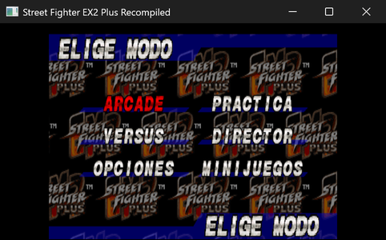
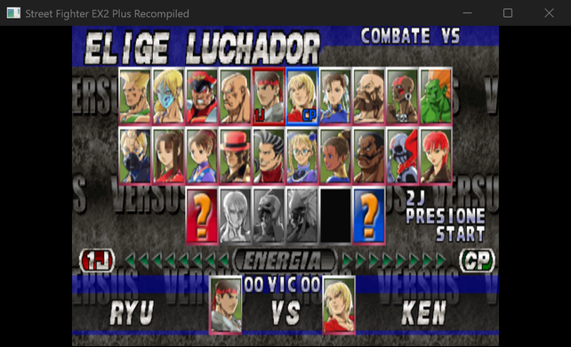
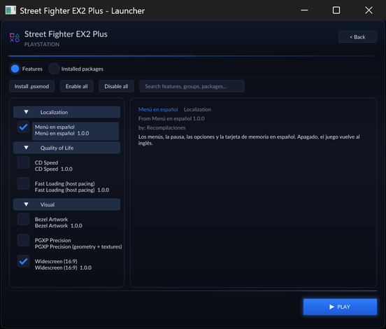

# Street Fighter EX2 Plus — Spanish menus

A Spanish localization of *Street Fighter EX2 Plus* (PlayStation, 1999, `SLUS-01105`) for the
[PSXRecomp](https://github.com/RetroPortingToolKit/psxrecomp) static recompilation, shipped as a **declarative mod
package**: 302 strings, 979 guarded patches, no modified disc image and no patched executable.
It switches on and off in the launcher.

*(Español — la versión completa: [README.es.md](README.es.md))*



> **Where it was tested:** on Windows, and on an **Xbox Series X** in Developer Mode through the UWP
> port of this game. A Series S has **never** been tried — nothing here has been measured on one.

## What is translated

- Title and loading screens, the main menu and its submenus, game and sound options, the
  memory card, the database, the ranking, the results screen and the pause menus of both a
  match and training.
- **The versus screen**, in full: the grid pointers and the health-bar plates read **1J** and
  **2J**, the bar reads **ENERGIA**, the scoreboard **00 VIC 00** and the second-player prompt
  **2J PRESIONE START**.
- The two gold arcade labels, **redrawn from the game's own letters** so they match the
  original artwork: **FASE 1** instead of "STAGE 1" before each fight, and **ELIGE PERS.**
  instead of "PLAYER SELECT".



What stays in English: fighter, stage and move names (proper nouns, most of them drawn as
artwork), the scoreboard jargon (HIT, DAMAGE, TOTAL…), and **CP** for the CPU side — it reads
just as well in Spanish.

The menu font has no accents and no `ñ`: accents are folded (`PRACTICA`), and words needing
`ñ` were rephrased rather than mangled. The memory-card font does have them, and uses them.
See [docs/TRANSLATION.es.md](docs/TRANSLATION.es.md) (Spanish).

## How it works

A `format_version = 5` declarative package. Each patch states the original bytes it expects
and is bound to the disc's SHA-256:

- **938 patches to the disc** (`target = "disc_user"`), because this game keeps its UI strings
  as plain ASCII inside the per-screen modules it loads from disc, and reloads them on every
  screen. The stock image is **not** rewritten: the runtime resolves these into a sparse
  overlay at load time.
- **41 patches to the executable** (`target = "main_exe"`), applied in RAM before the entry
  point, for the boot and button-config messages.

If the disc is not the one the package was built for, nothing is applied — it fails safe
rather than corrupting anything.

## What this repository is not

It contains **no game code, no disc image, no BIOS and no built executable**. You need your
own legally dumped copy of the game and a working PSXRecomp project for it. What is here is a
patch: the bytes to change and the bytes each change expects to find.

## Install

Download the **[latest release](https://github.com/jajdp/sfex2p-es/releases/latest)** and
extract it into your game project, next to the executable. The archive already carries the
folder structure, so that is the whole install:

```text
mods/packages/sfex2p.es/1.0.0/manifest.toml
```

Copying that same folder straight out of this repository works just as well — it is the same
file. Then launch the game and enable **Menú en español** under **Mods → Localization**. Step
by step, including consoles, in **[docs/INSTALL.md](docs/INSTALL.md)**.



## Compatibility

This mod only replaces menu text, so it does not get in the way of other mods for the same game —
a 16:9 one among them. They can be installed together.

## Status

Played through on Windows and on an Xbox Series X in Developer Mode, screen by screen.

Also verified from scratch on 2026-10-08, using nothing but this repository and the game's own:
the game built from source, this package dropped in, and the title screen reading **PULSA
START** on first boot.

Known gaps: the arcade endings have not been walked through yet, so English text may remain
there.

## Credits and license

**Almost none of what makes this work is ours.** This repository is a recipe that glues together other people's work; without any one of these pieces there would be no port at all.

| What it does | Who made it | License |
|---|---|---|
| **[psxrecomp](https://github.com/RetroPortingToolKit/psxrecomp)** — the PlayStation static recompiler ecosystem | **RetroPortingToolKit** | PolyForm Noncommercial 1.0.0 |
| **[Street-Fighter-EX2-Plus-Recompiled](https://github.com/strider973/Street-Fighter-EX2-Plus-Recompiled)** — recompiles *Street Fighter EX2 Plus* | **strider973** | none declared |

**The packaging recipe, the tooling and this documentation** are by **Recompilaciones**.


Translation and tooling by **Recompilaciones**. Released under the
[PolyForm Noncommercial License 1.0.0](LICENSE), matching the license of the PSXRecomp
framework it runs on.

*Street Fighter EX2 Plus* is © Capcom / Arika. This project is not affiliated with them, with
Sony, or with the PSXRecomp author, and it distributes nothing that belongs to them. The
details — exactly what is and is not included here, and how to ask for a takedown — are in
**[NOTICE.md](NOTICE.md)**. Rights holders can write to **jajdpmail@gmail.com**.
